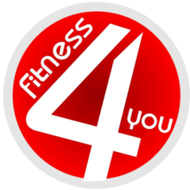
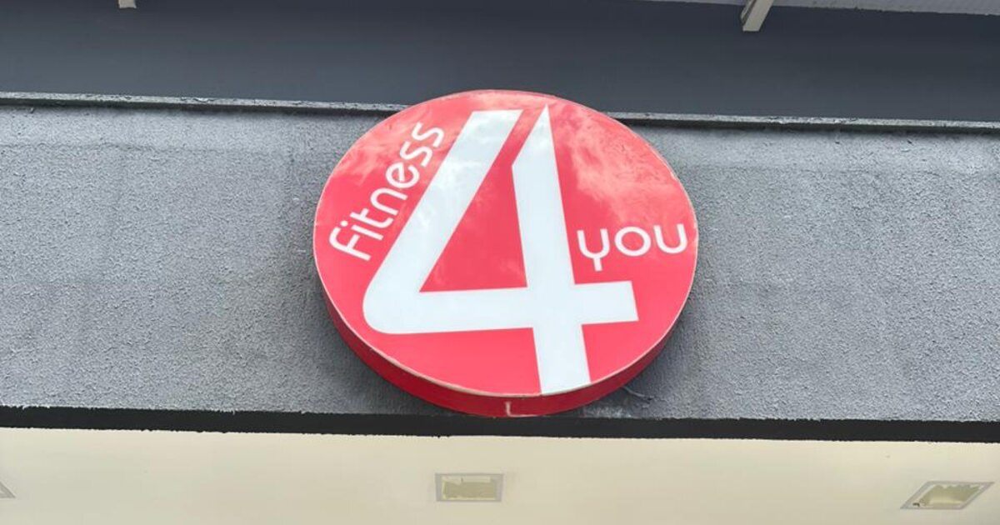

<div align="center">



# Fitness 4 You — Academia em Goiânia

**Site institucional da Fitness 4 You, academia com 12 anos de tradição na Vila Isaura, Goiânia (GO).**

[](https://www.fitness4you.app.br/)
[](https://www.instagram.com/fitness4youacademia/)
[](https://wa.me/5562996487510)


<br>



</div>

---

## Sobre o projeto

Landing page completa da academia **Fitness 4 You**, pensada para converter visitantes em alunos: apresenta a estrutura, as modalidades e os planos, e leva o visitante direto para o WhatsApp ou para o pagamento via Pix, sem etapas intermediárias.

É um site **estático, em um único arquivo HTML**, sem framework e sem etapa de build. Basta hospedar os arquivos para colocar no ar.

## Destaques

| | |
|---|---|
| 🏋️ **Musculação e ergometria** | Apresentação da estrutura principal da academia |
| 🥊 **12 modalidades coletivas** | Ritmos, Ritbox, Jump, Step, Funcional, Mobilidade, Mat Pilates, Studio Pilates, Muay Thai, Jiu-Jitsu, Crosskids e Jiu-Jitsu Kids |
| 💳 **Pagamento via Pix integrado** | QR Code e "copia e cola" por plano, com confirmação automática enviada pelo WhatsApp |
| 🤝 **Convênios** | Seção dedicada a Wellhub e TotalPass |
| 🎥 **Depoimentos em vídeo** | Vídeo institucional e depoimentos reais de alunos |
| 🕒 **Horário em tempo real** | Indica se a academia está aberta ou fechada no momento |
| ❓ **FAQ e política de privacidade** | Dúvidas frequentes e informações de tratamento de dados (LGPD) |
| 📱 **Responsivo** | Layout otimizado para celular, tablet e desktop |

## SEO

- Dados estruturados **Schema.org** (`LocalBusiness` / academia) com endereço, horários e redes sociais
- Meta tags **Open Graph** com imagem de compartilhamento dedicada
- `sitemap.xml` e `robots.txt`
- URL canônica e verificação no **Google Search Console**

## Estrutura

```
.
├── index.html          # Site completo (HTML, CSS e JS)
├── imagens/            # Logo, fachada, recepção, ícones e logos de convênios
├── modalidades/        # Fotos das aulas coletivas
├── videos/             # Vídeo institucional e depoimentos
├── QR Codes/           # QR Codes Pix de cada plano
├── robots.txt
└── sitemap.xml
```

## Como rodar localmente

Não há dependências para instalar. Clone o repositório e sirva a pasta com qualquer servidor estático:

```bash
git clone https://github.com/Gabriel-Grassmann/Fitness-4-You.git
cd Fitness-4-You
python3 -m http.server 8000
```

Depois acesse **http://localhost:8000**.

> Abrir o `index.html` direto no navegador também funciona, mas um servidor local evita problemas com o carregamento dos vídeos.

## Tecnologias

- **HTML5, CSS3 e JavaScript puro**, sem frameworks
- [Lucide Icons](https://lucide.dev/) via CDN
- Google Fonts: *Bebas Neue*, *Barlow Condensed* e *DM Sans*

## A academia

📍 Rua 15, esquina com Av. Senador Jaime, Qd I Lt 20/21, Vila Isaura, Goiânia (GO)

| Dia | Horário |
|---|---|
| Segunda a sexta | 05h às 23h |
| Sábado | 06h às 14h |
| Domingo | 08h às 12h |

🚗 Estacionamento gratuito

---

<div align="center">

Desenvolvido por **[Gabriel Solera](https://github.com/Gabriel-Grassmann)**

<sub>© Fitness 4 You. Todos os direitos reservados. A marca, as fotos e os vídeos pertencem à academia e não podem ser reutilizados sem autorização.</sub>

</div>
